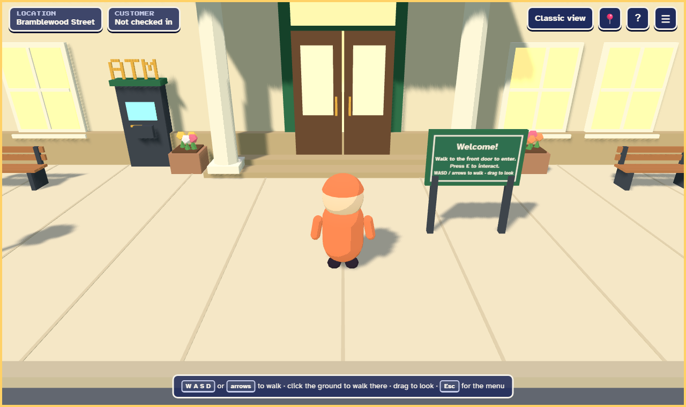
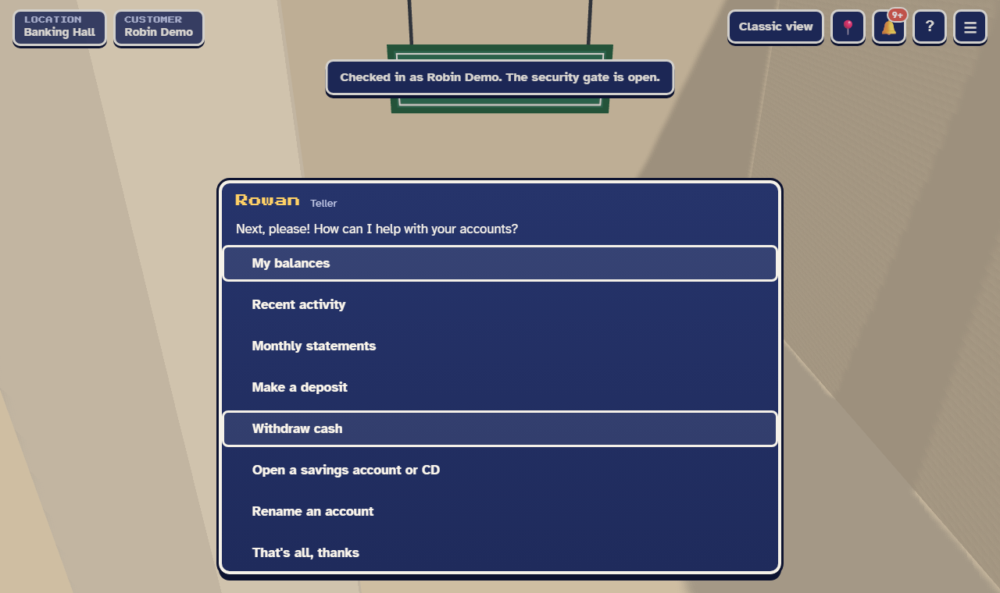
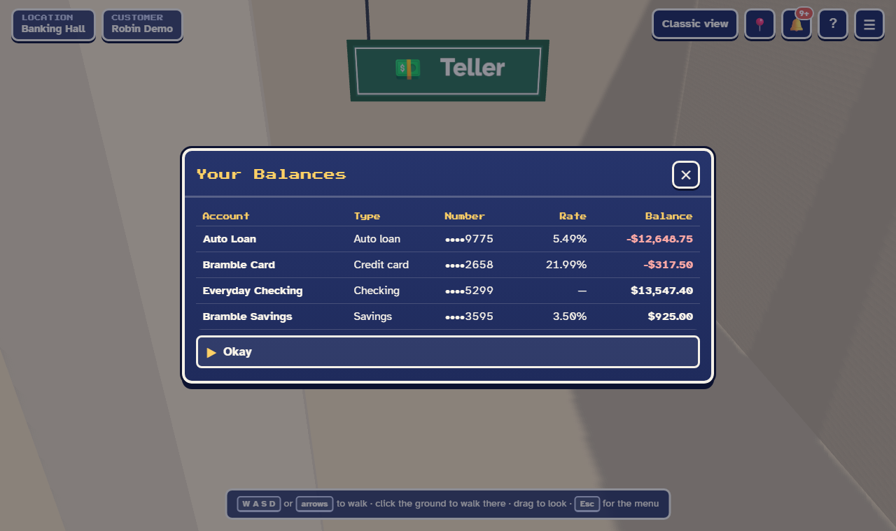
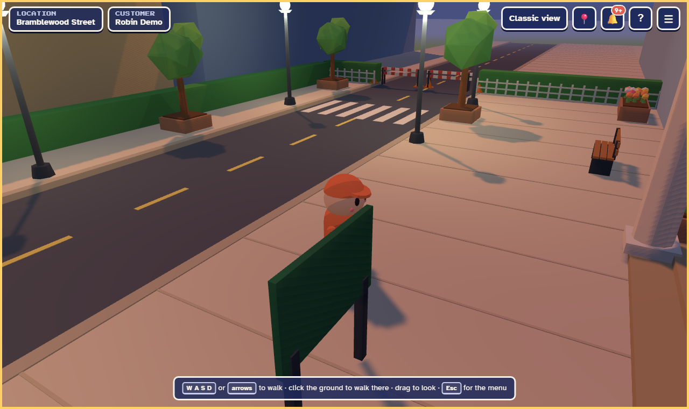
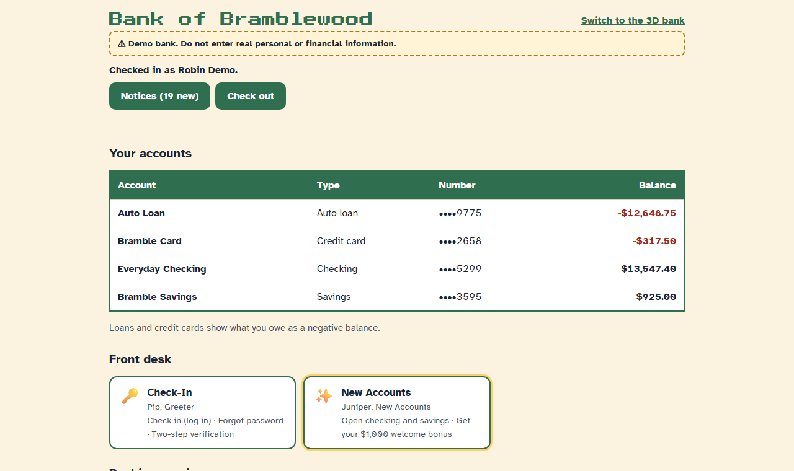

# Bank of Bramblewood

A fictional bank you visit as a small 3D world. Walk in, check in at the desk, and do your banking at retro RPG-style stations. No real money moves, but the backend behaves like a real bank: a double-entry ledger, interest, statements, loans, cards and insurance.

Prefer a plain web page? The **classic view** (`/classic.html`) does everything the 3D bank does, with no 3D.



| At the Teller                                               | Your balances                                         |
| ----------------------------------------------------------- | ----------------------------------------------------- |
|  |  |
| **Evening lighting**                                        | **Classic view**                                      |
|       |      |

> **Demo bank.** Bank of Bramblewood is fictional. Never enter real personal or financial information.

## Setup

Requires Node 22 or newer.

```bash
npm install
npm run db:seed
npm run dev
```

Then open http://127.0.0.1:5173. The API runs on http://127.0.0.1:3001. The SQLite database is created at `apps/api/prisma/dev.db` on first run.

**Demo login:** `demo@bramblewood.test` (or `sam@bramblewood.test`), password `bramblewood-demo-2026`.

## Getting around

- **Walk:** W A S D or the arrow keys. Hold Shift to run, or click the ground to walk there. Drag to look around.
- **Talk / interact:** E or Enter.
- **Quick travel:** T. Jump to any station.
- **Menu:** Escape.

A gamepad and touch controls work too.

**Settings** (Escape → Settings) cover look sensitivity, camera, text size, a readable font, high contrast, a colorblind-safe palette, reduced motion, remappable keys, sound volume and mute, time of day, and graphics quality.

See [docs/accessibility.md](docs/accessibility.md) for the full accessibility checklist.

Add `?debug` to the URL for an FPS and draw-call readout and collider wireframes. In development it also adds a time machine to the pause menu that moves the bank clock forward.

## Scripts

| Script                  | What it does                                                                  |
| ----------------------- | ----------------------------------------------------------------------------- |
| `npm run dev`           | API and web client together, watching                                         |
| `npm test`              | Vitest in every workspace                                                     |
| `npm run test:e2e`      | Playwright + axe on a fresh seeded database (ports 3101/5273)                 |
| `npm run test:e2e:prod` | The same specs against the production build (one origin, CSP, secure cookies) |
| `npm run typecheck`     | `tsc` in every workspace                                                      |
| `npm run lint`          | ESLint                                                                        |
| `npm run format`        | Prettier (write)                                                              |
| `npm run build`         | Build the web app into `apps/web/dist`                                        |
| `npm start`             | Run the API (and serve the web app when `WEB_DIST` is set)                    |
| `npm run db:seed`       | Add demo customers (safe to re-run)                                           |
| `npm run db:deploy`     | Apply migrations (production)                                                 |
| `npm run db:migrate`    | Create a migration after schema edits                                         |
| `npm run db:reset`      | Wipe the dev database and re-seed                                             |

The first `npm run test:e2e` needs Playwright's browser: `npx playwright install chromium`.

## Deploying

One Node process serves the API and the built web app, with SQLite on a persistent disk. See [docs/deploy.md](docs/deploy.md) for environment variables, a Linux + Caddy example, a PaaS checklist, backups, and how to move to Postgres later.

## Layout

```
apps/api         Fastify backend (Prisma + SQLite)
apps/web         Three.js client, menu UI, and the classic view
packages/shared  Bank config, money helpers, shared Zod schemas
e2e/             Playwright + axe specs
docs/            Plan, accessibility checklist, deploy guide, screenshots
```

See [docs/3d-bank-plan.md](docs/3d-bank-plan.md) for the full plan and changelog.
